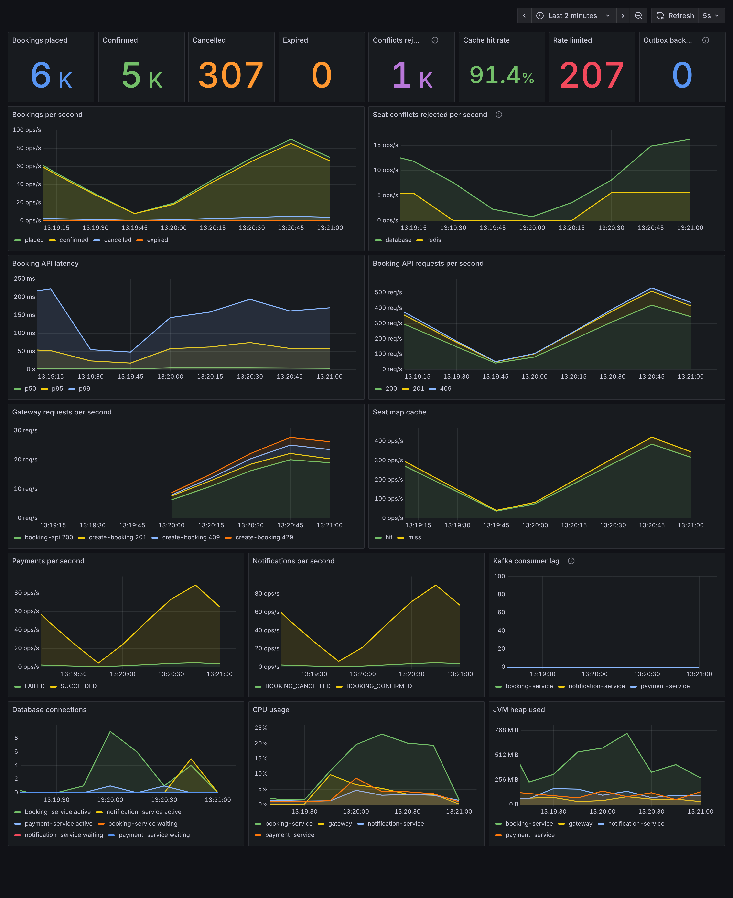
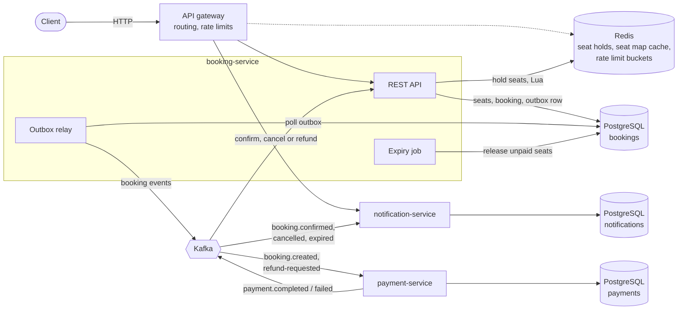
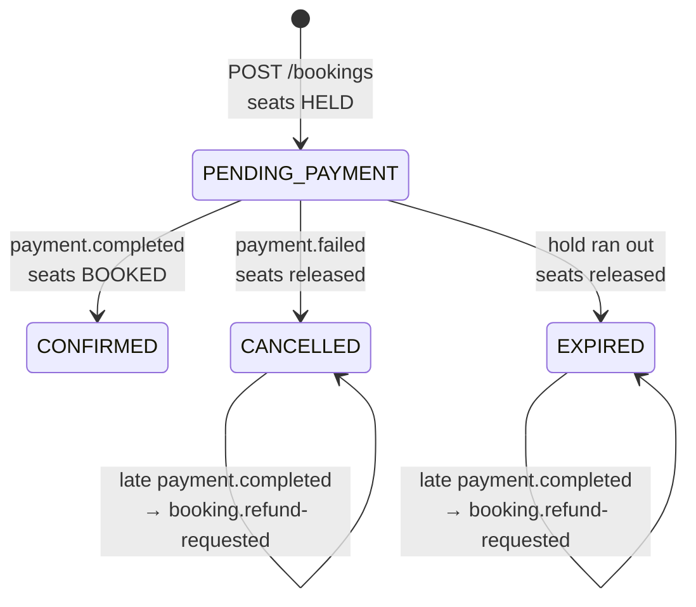

# Seat Booking System

[](https://github.com/ayushkzz/seat-booking-system/actions/workflows/ci.yml)


An event-driven backend for booking seats at shows, built around the hard parts of ticketing:
**two people grabbing the same seat at the same moment, clients retrying requests, payments that
fail or arrive too late, and services that must stay consistent without distributed transactions.**

- **No double booking under concurrency.** 200 simultaneous requests for one seat produce exactly one booking (covered by an integration test).
- **Idempotent API.** Retrying a request with the same `Idempotency-Key` returns the original booking instead of creating a second one.
- **Transactional outbox.** A booking and its `booking.created` event are committed together, so the database and Kafka never disagree.
- **Saga with compensation.** Payment success confirms the booking, a decline releases the seats, and a payment that arrives after the hold expired triggers a refund.
- **Self-healing holds.** Unpaid bookings expire automatically and their seats return to sale.
- **API gateway with rate limiting.** One entry point; each client gets a Redis token bucket, with a stricter limit on creating bookings.
- **Measured, not assumed.** A k6 load test holds 500 requests/s at a booking p95 of 154 ms on a single 4-vCPU machine, then verifies zero double bookings and that three separate databases agree exactly. See [the results](docs/LOAD_TEST.md).



## Architecture



Each service owns its database. They communicate only through Kafka, and every message is keyed
by booking id, so all events for one booking are processed in order.

| Service | Port | Responsibility |
| --- | --- | --- |
| gateway | 8000 | Single entry point. Routes requests and rate-limits each client. |
| booking-service | 8080 | Shows, seat maps, seat holds, bookings, the outbox and the saga. |
| payment-service | 8081 | Simulated payment provider. Charges each booking at most once, and refunds. |
| notification-service | 8082 | Turns booking events into notifications, once per event. |

### Booking lifecycle



## How double booking is prevented

A booking request passes three independent guards. Each one alone would catch most conflicts;
together they stay correct even when one of them fails.

| Guard | Where | What it does |
| --- | --- | --- |
| **Idempotency lock** | Redis `SET NX` | Requests that share an `Idempotency-Key` never run concurrently. A completed retry returns the stored booking (unique on user + key in PostgreSQL). |
| **Atomic seat hold** | Redis Lua script | Holds *all* requested seats or none, in one atomic step. Rejects most conflicts in about a millisecond, without touching the database. Keys use a `{show:id}` hash tag so a show's seats share one Redis Cluster slot. |
| **Compare-and-set** | PostgreSQL | `UPDATE seats SET status='HELD' WHERE id IN (...) AND status='AVAILABLE'`. If fewer rows change than requested, the transaction rolls back. This is the source of truth: even if Redis loses a hold, a seat can't be sold twice (covered by a test that deletes the Redis keys). |

## Reliability patterns

- **Transactional outbox.** `booking.created` is written to an `outbox_events` table in the same transaction as the booking. A relay publishes pending rows to Kafka, waits for the acknowledgement, then marks them as sent. Rows are claimed with `FOR UPDATE SKIP LOCKED`, so several instances can relay in parallel.
- **Idempotent consumers.** Delivery is at-least-once. payment-service stores one payment per booking (unique constraint), so a redelivered event re-publishes the stored result instead of charging twice. booking-service only acts on bookings still in `PENDING_PAYMENT`, under a row lock.
- **Dead-letter topics.** A message that keeps failing is retried 3 times, then moved to `<topic>-dlt` so it doesn't block the partition.
- **Expiry job.** Bookings not paid within the hold time (5 minutes by default) are expired, and their seats are released. It also uses `SKIP LOCKED`, so it's safe to run on every instance.
- **Rate limiting at the gateway.** Spring Cloud Gateway keeps a token bucket per client and route in Redis. Creating bookings is limited to 5 requests/s (burst 10) per client; everything else to 50/s (burst 100). Excess requests get `429`.
- **Seat map cache.** The rendered seat map is cached in Redis for one second. It is deliberately not evicted on every booking: during a rush that would make most reads miss. A seat map can be a second old, but a booking is always checked against the real data.
- **Threads.** Web requests run on Java 21 virtual threads. Kafka consumers run on platform threads, because a consumer blocked in `poll()` pins its carrier thread ([what the load test found](docs/LOAD_TEST.md#what-the-test-found)).

## API

| Method | Path | Description |
| --- | --- | --- |
| `POST` | `/api/shows` | Create a show with a rows × seats layout |
| `GET` | `/api/shows/{id}` | Show details |
| `GET` | `/api/shows/{id}/seats` | Seat map with a summary per status |
| `POST` | `/api/shows/{id}/bookings` | Hold seats and start payment. Needs an `Idempotency-Key` header. `201` new, `200` replay, `409` seat taken |
| `GET` | `/api/bookings/{id}` | Booking status |
| `GET` | `/api/users/{userId}/notifications` | The user's 50 most recent notifications |

All of it is served through the gateway on port 8000. A client that sends requests too fast gets `429 Too Many Requests`.

Errors use [RFC 9457](https://www.rfc-editor.org/rfc/rfc9457) problem responses with a stable `code`:

```json
{
  "status": 409,
  "title": "Conflict",
  "code": "seat-unavailable",
  "detail": "One or more of the requested seats are already held or booked.",
  "instance": "/api/shows/1/bookings"
}
```

### Try it

```bash
docker compose up -d --build
```

```bash
# Seat map of the demo show (10 rows × 20 seats)
curl -s localhost:8000/api/shows/1/seats | jq '.summary'
```

```bash
# Book two seats
curl -s -X POST localhost:8000/api/shows/1/bookings \
  -H 'Content-Type: application/json' -H 'Idempotency-Key: 6f1c2a' \
  -d '{"userId":"ayush","seatIds":[1,2]}' | jq
```

```bash
# A moment later the payment saga has confirmed it
curl -s localhost:8000/api/bookings/<id> | jq '.status'
```

```bash
# ...and the user has been notified
curl -s localhost:8000/api/users/ayush/notifications | jq
```

Users whose id starts with `decline` always have their payment declined, which is handy for trying
the cancellation path. Other payments fail randomly at `PAYMENT_FAILURE_RATE` (default 10%).

## Running the tests

```bash
./mvnw verify
```

The integration tests start the whole service against real PostgreSQL, Redis and Kafka using
[Testcontainers](https://testcontainers.com), so Docker must be running. They cover:

- 200 concurrent requests for one seat → exactly one `201`, 199 × `409`
- the database guard when the Redis hold is lost
- idempotent retries, and rejection of a reused key for a different request
- `booking.created` published through the outbox
- payment completed → confirmed, payment failed → seats released
- hold expiry, then a late payment → refund requested
- payment-service charging once per booking under redelivery, declines and refunds
- notification-service notifying once per event under redelivery
- gateway routing, and `429` once a client exceeds its booking rate

To reuse the Docker Compose infrastructure instead of starting new containers each time:

```bash
docker compose up -d postgres redis kafka
```

```bash
ITEST_LOCAL=true ./mvnw verify
```

`scripts/smoke-test.sh` runs the full saga end to end against running services. CI runs it against
the Docker Compose stack on every push.

## Local development

[docs/DEVELOPMENT.md](docs/DEVELOPMENT.md) covers setting up your machine, running the services
from an IDE against the Docker infrastructure, the Postman collection, configuration and
troubleshooting.

## Load test

`scripts/load-test.sh` starts the stack, runs a k6 test (seat map reads, bookings, and 300 users
rushing one seat), then checks the databases for double bookings and for agreement between the
services. Results and how to read them are in [docs/LOAD_TEST.md](docs/LOAD_TEST.md).

## Observability

```bash
docker compose --profile monitoring up -d --build
```

adds Prometheus (http://localhost:9090) and Grafana (http://localhost:3000, no login) with a
ready-made dashboard: booking outcomes, rejected seat conflicts by layer, API latency percentiles,
gateway traffic and rate limiting, cache hit rate, payments, notifications, Kafka consumer lag,
outbox backlog, database connections, CPU and heap.

Every service exposes `/actuator/health` (with liveness and readiness probes) and
`/actuator/prometheus`. Custom metrics include `bookings_placed_total`, `bookings_confirmed_total`,
`bookings_seat_conflicts_total{layer="redis|database"}`, `seatmap_cache_requests_total{result}`,
`outbox_pending`, `payments_processed_total{status}` and `notifications_sent_total{type}`.

## Project structure

```
common/                event records and topic names shared by the services
booking-service/       shows, seat holds, bookings, outbox relay, saga handlers, expiry job
payment-service/       simulated payment provider; idempotent charges and refunds
notification-service/  notifications from booking events, once per event
gateway/               Spring Cloud Gateway: routing and Redis rate limiting
loadtest/              k6 load test
scripts/               end-to-end smoke test and load test runner
postman/               Postman collection that walks through the booking saga
docs/                  local development guide, load test results
docker/                PostgreSQL init script, Prometheus and Grafana configuration
```

## Tech stack

Java 21 (virtual threads) · Spring Boot 4 · Spring Cloud Gateway · Spring Data JPA / Hibernate ·
Flyway · Spring Kafka · Spring Data Redis · PostgreSQL 16 · Redis 7 · Apache Kafka 4 (KRaft) ·
Micrometer · Prometheus · Grafana · k6 · JUnit 5 · Testcontainers · Awaitility · Docker Compose ·
GitHub Actions

The gateway runs on Spring Boot 4.0 and the other services on 4.1, because Spring Cloud Gateway
has no stable release for Boot 4.1 yet.

## Possible next steps

- Real email or SMS delivery behind the `NotificationSender` interface
- User accounts and authentication at the gateway (JWT), instead of a `userId` in the request
- A waiting room that queues users when a show goes on sale
- Kubernetes manifests with horizontal scaling of booking-service
