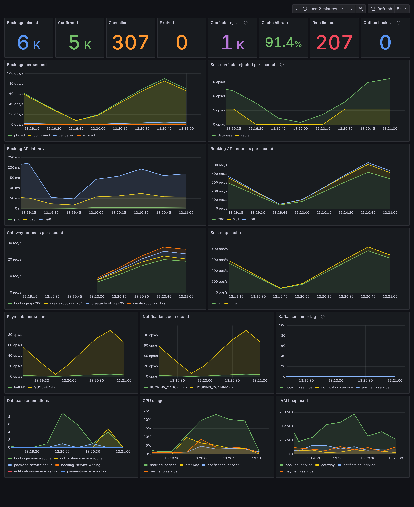

# Load test

A [k6](https://k6.io) test that puts the system under mixed traffic and then checks the data for
double bookings and for agreement between the services.

## Result

Measured on one 4-vCPU, 15 GB virtual machine (Intel Xeon 2.1 GHz) that ran **everything at once**:
the four services, PostgreSQL, Redis, Kafka, Prometheus, Grafana and the k6 load generator.

| | |
| --- | --- |
| Load | **500 requests/s for 60 s**: 400 seat-map reads/s + 100 booking requests/s |
| Requests served | 30,301, with **0 server errors** and 0 requests dropped by the load generator |
| Seat map latency | median 3 ms, **p95 48 ms**, p99 125 ms |
| Booking latency | median 16 ms, **p95 154 ms**, p99 262 ms |
| Bookings created | 5,218 (73/s). 782 requests were correctly rejected with `409` because the seat was taken |
| Rush for one seat | 300 users booked the same seat at the same moment: **exactly 1 succeeded**, 299 got `409` |
| Seat map cache | 86–91% of reads served from Redis |

After the run, with the payment saga finished (figures include the warm-up):

| Check | Result |
| --- | --- |
| Seats sold to more than one booking | **0** |
| Bookings still waiting for payment | 0 |
| Seats marked booked = seats in confirmed bookings | 13,948 = 13,948 |
| Successful payments = confirmed bookings | 9,372 = 9,372 |
| Failed payments = cancelled bookings | 467 = 467 |
| Notifications = finished bookings | 9,839 = 9,839 |

The last three rows compare three separate databases that only communicate through Kafka. They
agree exactly: no event was lost and none was applied twice.



## What the test does

`loadtest/booking.js` runs three things at once:

- **Browse:** seat maps of 30 shows (1,300 seats each) are requested at a constant rate.
- **Book:** bookings for one seat or two neighbouring seats, picked at random, arrive at a constant
  rate. As shows fill up, more of them collide and get `409`.
- **Rush:** halfway through, 300 users try to book the same seat simultaneously.

Arrival rates are constant (`constant-arrival-rate`), so a slow system cannot hide by receiving
fewer requests: if it falls behind, k6 reports dropped iterations and the test fails.

The run fails unless all of these hold: no `5xx` responses, exactly one winner in the rush, no
dropped iterations, seat map p95 under 100 ms and booking p95 under 250 ms.

## How to read these numbers

- **They are a floor, not a ceiling.** The load generator and the monitoring stack competed with
  the services for the same four cores. On this machine response times start to climb at about
  750 requests/s and the system is saturated near 900.
- **The test bypasses the gateway** and calls booking-service directly, because the gateway
  rate-limits per client and a load generator is a single client.
- **Payments are simulated.** For the test the fake provider answers in 10–50 ms and declines 5%
  (`docker-compose.loadtest.yml`). A real provider is slower, but that affects how long a booking
  waits for confirmation, not the booking API's latency: the API answers as soon as the seats are
  held.
- **The run is measured warm.** A freshly started JVM runs interpreted code and is several times
  slower for its first minute, so the script sends 90 seconds of lighter traffic first. Without
  the warm-up, the same load overwhelms a cold instance. In production you would ramp traffic up
  to new instances for the same reason.

## Run it yourself

```bash
./scripts/load-test.sh
```

This builds and starts a fresh stack with the load-test settings, warms it up, runs the test,
waits for the saga to settle, runs the data checks, and stops the stack. It needs Docker, `curl`
and `jq`, and takes about five minutes.

To watch it live, keep the stack running and open Grafana at http://localhost:3000:

```bash
KEEP_STACK=1 ./scripts/load-test.sh
```

Change the load with environment variables:

```bash
BROWSE_RATE=600 BOOK_RATE=150 DURATION=120s ./scripts/load-test.sh
```

| Variable | Default | Meaning |
| --- | --- | --- |
| `BROWSE_RATE` | `400` | Seat map requests per second |
| `BOOK_RATE` | `100` | Booking requests per second |
| `DURATION` | `60s` | Length of the measured run |
| `HOT_SEAT_USERS` | `300` | Users in the rush for one seat |
| `SHOWS` | `30` | Shows created for the test (1,300 seats each) |

## What the test found

Running it exposed two problems that are now fixed:

- **Kafka consumers on virtual threads stalled the services.** With virtual threads enabled, each
  consumer's blocking `poll()` pinned a carrier thread. With a dozen consumers every carrier was
  pinned, health checks stopped answering and the consumer group never stabilised. Consumers now
  run on platform threads; web requests stay on virtual threads.
- **Evicting the seat map cache on every booking made it useless under load.** The cache was
  cleared each time a seat changed, so during a rush nearly half of all reads rebuilt a 1,300-seat
  map from PostgreSQL. Entries now simply expire after one second, which keeps the hit rate near
  90% at the cost of a seat map that can be one second old.
